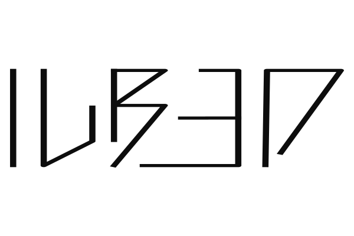

# IUBEO

> 現実のAIと人間、概念的な立場が逆転している世界
> 人は道具であり、リソースである。

<p align="center">
  <picture>
    <source media="(prefers-color-scheme: dark)" srcset="docs/assets/iubeo_logo_dark.svg">
    
  </picture>
</p>

## 技術スタック

### アプリ

- フロント (Web)
  - [React](https://react.dev/) (UI)
    - [Three.js](https://threejs.org/) + [@react-three/fiber](https://r3f.docs.pmnd.rs/) (3D・WebGPU レンダラー)
  - [thirdlf03/firefox-wasm](https://github.com/thirdlf03/firefox-wasm) (ゲーム内 PC の Web 検索エンジン)
  - [@mercuryworkshop/wisp-js](https://github.com/MercuryWorkshop/wisp-protocol) (WISP プロキシクライアント)
- バックエンド (サーバー)
  - [Go](https://go.dev/) (セッション管理・マッチメイキング)
    - [coder/websocket](https://github.com/coder/websocket) (リアルタイム通信)
    - [oapi-codegen](https://github.com/oapi-codegen/oapi-codegen) (OpenAPI スキーマ定義・コード生成)

### インフラ

- [Cloudflare Workers](https://workers.cloudflare.com/) (フロント配信: Static Assets)
- [AWS EC2](https://aws.amazon.com/ec2/) + Elastic IP (本番バックエンド)
  - [Cloudflare Containers](https://developers.cloudflare.com/) (開発用・フォールバック・WISP)
- [Terraform](https://www.terraform.io/) (インフラ管理)


### 開発環境

- [devenv](https://devenv.sh/) + [Nix](https://nixos.org/)
- [Docker Compose](https://docs.docker.com/compose/)
- [Vite](https://vite.dev/) + [pnpm](https://pnpm.io/)
- [air](https://github.com/air-verse/air) (Go ホットリロード)

## 環境構築

ブラウザは Google Chrome 推奨。WebGPU を使用する。

- フロント: `5173`（http://localhost:5173/?debug）
- バックエンド: `8080`
- WISP: `5001`

以下のいずれかの方法で環境を用意する。

### devenv

```sh
curl -fsSL https://install.determinate.systems/nix | sh -s -- install   # Nix
nix profile install nixpkgs#devenv                                      # devenv
direnv allow                                                            # リポジトリのルートで（.envrc）
devenv up
```

一回、ディレクトリから抜けて再度入ると環境構築完了。`devenv up` で起動する（初回は Nix のビルドに時間がかかる）。

### Docker Compose

```sh
docker compose up
```

Go と Node.js はコンテナ側で用意される（`compose.yaml`）。止めるときは `docker compose down` を実行する。

### 手動

Go 1.27 と Node.js 24、pnpm 11（`corepack enable`）を用意し、2つのターミナルでそれぞれ実行する。

```sh
# ターミナル 1
cd backend && go mod download
IUBEO_SIGNING_KEY='iubeo-dev-only-signing-key-do-not-use-in-prod' IUBEO_ALLOWED_ORIGINS='http://localhost:5173' go run ./cmd/server

# ターミナル 2
cd frontend && pnpm install && pnpm dev
```

設定項目は `backend/internal/config` にあり、開発用の既定値は `devenv.nix`・`compose.yaml`・`frontend/.env.development` に置かれている。

## Gecko エンジンのセットアップ

Gecko エンジン（約 34MB）を [thirdlf03/firefox-wasm](https://github.com/thirdlf03/firefox-wasm) の Releases から取り込む。取り込まなくても起動するが、PC の画面は「NO ENGINE」になる。

```sh
cd frontend && pnpm engine:setup
```

## ドキュメント

- フロント（開発・デバッグ・規約）: [frontend/README.md](frontend/README.md)
- バックエンドの状態設計: [docs/backend/state-schema.md](docs/backend/state-schema.md)
- ボイスチャット: [docs/voice-chat.md](docs/voice-chat.md)
- 設計判断（ADR）: [docs/adr/](docs/adr/)
