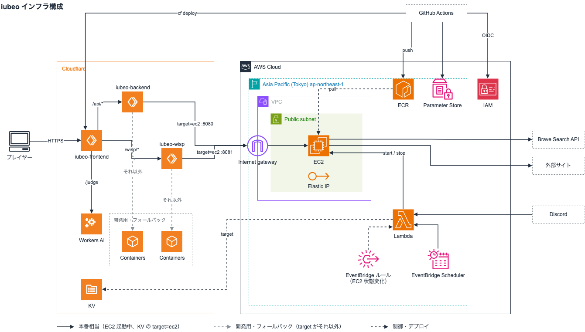

# ADR-0005: デプロイ構成

- 日付: 2026-10-07
- ステータス: Accepted
- 関連: [ADR-0002](ADR-0002-backend-technology-selection.md) / [ADR-0004](ADR-0004-backend-session-runtime.md) / [infra/aws/terraform/README.md](../../infra/aws/terraform/README.md) / [backend/cmd/loadtest/README.md](../../backend/cmd/loadtest/README.md)

## 背景

> どのような状況・制約・力関係のもとでこの決定が必要になったのか。

- 背景: **フロント(React + Vite の SPA)とバックエンド(Go。セッションごとにメモリで状態を持つ)を、どこにどう置くかを決める必要がある**
  - 新規の構成なので、Cloudflare の新しい CLI(`cf`)を使いたい
  - プレイヤーはまず日本中心。ゲーム中のレイテンシを安定させたい
  - ADR-0004 のとおり、バックエンドの状態はメモリのみで、**プロセスは 1 つに固定**する
  - 長期運用したいので、固定費を抑えたい

## 決定



以下を採用する。

1. **フロントは Cloudflare Workers Static Assets で配信し、`cf` でデプロイする**
   - Worker は `iubeo-frontend`(静的アセット + 中継)。静的アセットのリクエストは無料・無制限なので、フロントの費用は $0
   - `/api/*`・`/healthz` はバックエンドの Worker へ、`/wisp/*` は WISP の Worker へ、サービスバインディングで流す。`/judge`(検索の判定)はこの Worker が自分で受ける
1. **バックエンドの Worker(`iubeo-backend`)はフロントと分ける**
   - コンテナを持つ Worker は Worker Previews に対応していないため。フロントだけをプレビューできるようにする(プレビューは本番のバックエンドを向く)
1. **転送先は KV の `target` で切り替える**
   - `ec2` なら EC2(東京)へ、それ以外なら Cloudflare Containers へ流す(`frontend/worker/backend.ts`)
   - 転送先が落ちていても、黙って他方へは流さない。セッションはメモリ上にしか無く、2 つのバックエンドは状態を共有しないので、切り替わるとプレイヤーが別々のゲームに分裂するため
1. **開発用・フォールバックのバックエンドは Cloudflare Containers に置く(Go のコンテナをそのまま載せる)**
   - `schedulingPolicy: "durable-object"`、`standard-1`。Durable Object は名前を固定した 1 つ(`getByName("game")`)なので、コンテナも 1 つ
   - 5 分アクセスが無ければコンテナが眠るので、**触っていない間は $0**
1. **画面と API は同じオリジンにする**
   - プレイヤーの Cookie は `SameSite=Lax` なので、別サイトに置くと送られず 401 になる。`workers.dev` は Public Suffix List にあるため、別サブドメインは「別サイト」扱いになる
1. **本番相当(東京)は EC2 + Elastic IP にして、必要なときだけ起動する**
   - EIP は停止しても解放されず**アドレスも変わらない**ので、Worker の向き先(`iubeo-origin.thirdlf03.com`)を書き換えずに済む
   - 停止中の固定費は **$4.57/月**(EBS + EIP)で、ECS の $25.64/月 と比べて圧倒的に安い
   - 起動・停止は Lambda が行う(Discord の `/ec2start` `/ec2stop`)。起動したら `/healthz` が返るのを待って KV の `target` を `ec2` にし、停止するときは先に KV を消してから止める。自動停止は EventBridge Scheduler に「N 時間後(既定 3 時間)の 1 回」を登録して行う
1. **AWS 側は EC2 + EIP と、その起動・停止とデプロイの仕組みだけにする(ALB / ECS / NAT / ACM は使わない)**
   - `infra/aws/terraform/` がその実体。VPC / 公開サブネット 1 / IGW / SG / EC2 / EIP / ECR(backend・wisp)/ IAM、起動・停止の Lambda と Function URL・EventBridge Scheduler、デプロイ用の GitHub OIDC と SSM パラメータ
   - ALB を置かないので ACM 証明書も不要。TLS は Cloudflare で終わり、Worker から EC2 へは HTTP(8080)で流す
   - セキュリティグループは 8080(backend)と 8081(WISP)を **Cloudflare の IP 帯のみ**許可し、SSH は開けず SSM Session Manager で操作する
   - 署名鍵は初回起動時にインスタンス上で生成する。Secrets Manager を使わないので state に秘密が入らない
1. **WISP(PC の画面が実サイトへ出るプロキシ)も同じ形にする**
   - `iubeo-wisp` の Worker が KV の `target` を見て、`ec2` なら EC2 の 8081 へ、それ以外は Cloudflare のコンテナへ流す。EC2 から出ると出口が EIP になり、検索エンジンに弾かれにくい

```text
ブラウザ ──▶ iubeo-frontend(Workers Static Assets の SPA + 中継)
   │             ├─ /api/*, /healthz ──▶ iubeo-backend ─┬─ target=ec2 ──▶ EC2 + EIP :8080(東京 / 本番相当)
   │             │                                       └─ それ以外 ────▶ Durable Object ──▶ Cloudflare Container
   │             ├─ /wisp/* ──────────▶ iubeo-wisp ─────┬─ target=ec2 ──▶ EC2 + EIP :8081
   │             │                                       └─ それ以外 ────▶ Durable Object ──▶ Cloudflare Container
   │             └─ /judge ───────────▶ Workers AI(検索の判定)
   └─ 同じオリジンなので Cookie が飛ぶ
```

理由:

- **固定費が 1 桁安い。** AWS(ECS/Fargate + ALB)はアクセスが無くても $47.28/月かかるのに対し、Cloudflare は Workers Paid の $5/月 + コンテナの起動時間だけで済む。開発用に常設しても、遊ばれていない間は眠るのでほぼ $0
- フロントは既に `cf` で動いており、Go サーバーはコンテナなのでそのまま載る
- 1 セッション = 1 プロセスという ADR-0004 の制約は、名前を固定した Durable Object 1 つでそのまま表現できる
- ただし**コンテナは東京に固定できない。** 実測では大阪(kix06)に配置された。Cloudflare の配置制約は `APAC` のような広い単位しか無く、しかも DO ポリシーでは `constraints` 自体が使えない(Durable Object の `locationHint` は `apac-ne` にしてある)。**レイテンシを詰めたいときは東京に置ける EC2 へ逃がす**

## 実測(2026-10-07、実際にデプロイして計測)

| 項目 | 値 |
| --- | --- |
| コンテナの配置 | **大阪(kix06, APAC)**。Worker も KIX |
| コールドスタート | **6.03 秒**(温まっていれば 0.28 秒) |
| RTT (9 クライアント) | p50 56.8ms / p95 81.3ms / p99 102.1ms |
| 配信間隔 | p50 **50.1ms**(20Hz を維持) / p95 54.9ms |
| 切断 | 0 |
| ローカル実行との差 | RTT p50 で約 +26ms(tick の挙動は同一なので経路の差) |

## 実装上の制約(2026-10-07 時点の `cf` 1.0.0-beta.12 で確認)

- **`schedulingPolicy: "durable-object"` が必要。** 既定の schedulingPolicy だと実行時に `container.images` が空(`{}`)になり、`start({image, env})` に渡す image が取れないため、**署名鍵をコンテナに渡せず Go サーバーが起動しない**(実機で確認)。`cf` 本体の `fixtures/vite-container-project` は既定のポリシーだが、あれは env を渡さない例
- **その代わり `env` に Durable Object バインディングを置いてはいけない。** 置くと自己参照でも `script_name` 付きで出力され、`cf deploy` が「別 Worker の DO を参照している」として失敗する。Worker 側は `ctx.exports.Backend` で自分の DO を参照する
- **DO 管理では `instanceType` を設定に書けない**(スキーマが `strictObject` で拒否する)。起動時の `instance` でしか指定できず、**`basic`(0.25 vCPU / 1 GiB)は選べない**。`lite` / `standard-1`〜`4` のみ
- **初回デプロイは secrets file が必須**(`cf deploy --secrets-file`)。既存 Worker なら `cf workers secrets update <name> --text <value>`
- **scheduling policy は後から変更できない。** 変更するにはコンテナアプリを消して作り直す必要がある。`cf containers applications delete <id> --force`(非対話だと `--force` が要る)
- **Worker Previews(`cf previews deploy`)はコンテナに対して使えない。** プレビューのコンテナが本番の Durable Object ネームスペースに紐づいてしまい、`DURABLE_OBJECT_ALREADY_HAS_APPLICATION` で失敗する([cloudflare/cf#210](https://github.com/cloudflare/cf/issues/210)、2026-10-06 起票・未修正)

## 検討した選択肢

### 案B: AWS ECS/Fargate + ALB

- 概要: 東京リージョンに Fargate のタスクを 1 つ置き、ALB の背後に出す。Terraform で一元管理する
- 利点: 常時起動なのでコールドスタートが無い。リージョンとネットワーク経路を完全に制御できる。マネージドな TLS 終端とヘルスチェックが付く
- 欠点 / リスク: **アクセスが無くても $47.14/月かかる。** ALB とそのパブリック IPv4 だけで $25.04 を占め、これは止められない(消すしかない)
- 却下理由: 固定費が Cloudflare の 7 倍近い。ADR-0004 でタスクを 1 つに固定する以上、ECS の本来の価値(複数タスクのオーケストレーション)も使えない。ECS 用の Terraform は EC2 の構成に置き換えたので、常時起動が必要になって戻すなら書き直しになる

### 案C: AWS Lightsail

- 概要: 東京の Lightsail バンドル($12 = 2 vCPU / 2 GiB / 60 GB SSD / 静的 IP / 転送 3 TB 込み)に載せる
- 利点: AWS 内で完結し、静的 IP と転送が料金に含まれる。ALB が要らないので経路も短い
- 欠点 / リスク: OS のパッチと障害復旧を自分で持つ。小さいプランはバースト型で、CPU クレジットが切れるとレイテンシが乱れる
- 却下理由: Cloudflare Containers のほうが安く、OS を持たなくて済む。常時起動が前提になったら再検討する

### 案D: Cloud Run(asia-northeast1)

- 概要: バックエンドを Cloud Run の東京リージョンに置く
- 利点: コンテナをそのまま動かせ、必要なら 0 まで縮む
- 欠点 / リスク: 接続がリクエストのタイムアウト設定の影響を受け、WebSocket の切断と再接続の設計が要る。状態をメモリに持つ前提ではインスタンスの入れ替わりが進行中のセッションを消す
- 却下理由: フロントを Cloudflare に置く以上、Cloudflare Containers のほうが構成もコストも素直

### 案E: Cloudflare Containers に載せず、Durable Object に書き換える

- 概要: Go サーバーを TypeScript の Durable Object に移植する
- 利点: アイドル時もコールドスタートが無く、$5/月が下限。スケールも良い。ADR-0004 の設計(1 セッション = 1 ゴルーチン、純粋な関数)は Durable Object にほぼそのまま乗る
- 欠点 / リスク: Go の実装 1,895 行とテスト 1,614 行(2026-10-07 時点)の書き換えになる
- 却下理由: 今は Go のコンテナをそのまま載せられるので、書き換えの見返りが小さい。**コールドスタートが問題になったら、ADR-0004 の設計を活かしてこの案に進む**
